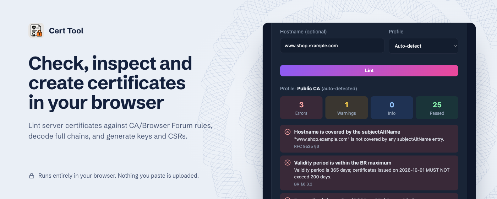
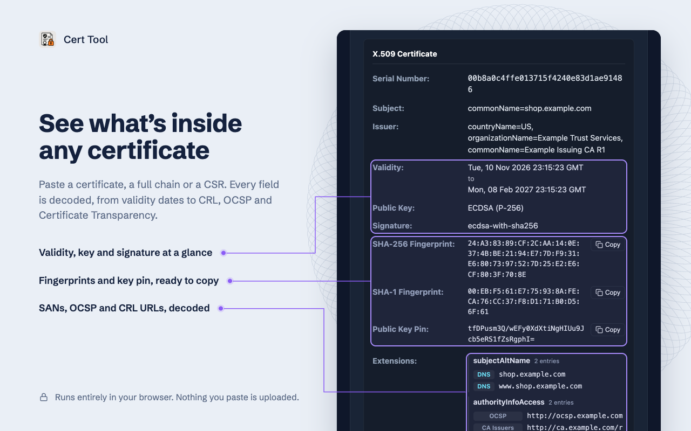
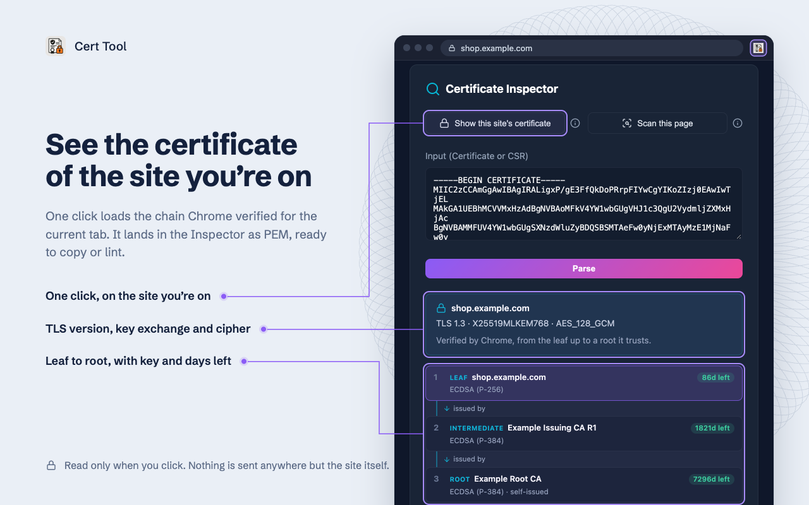
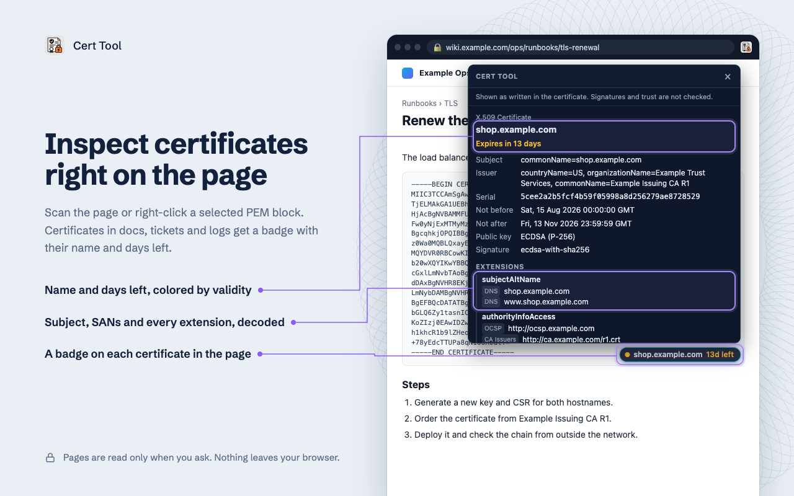
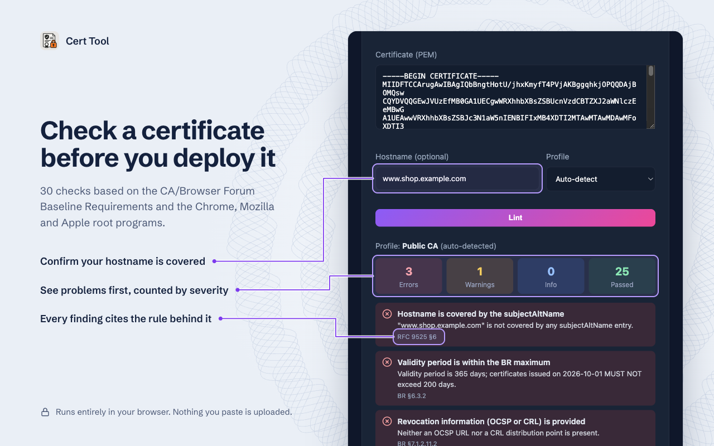
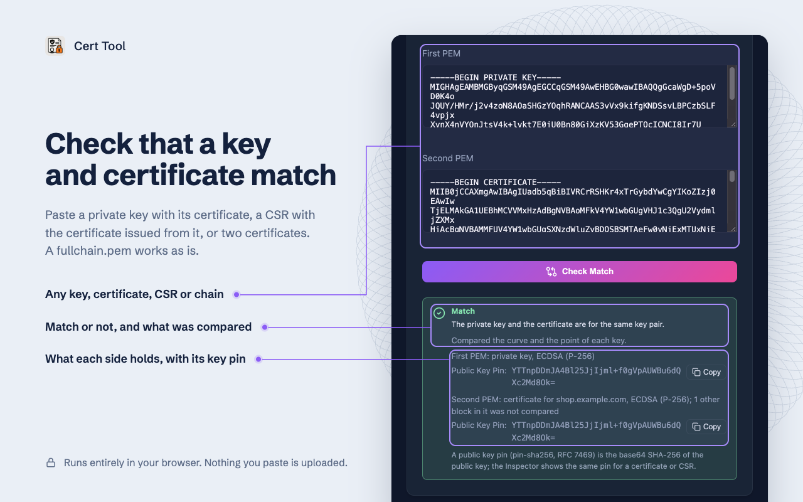
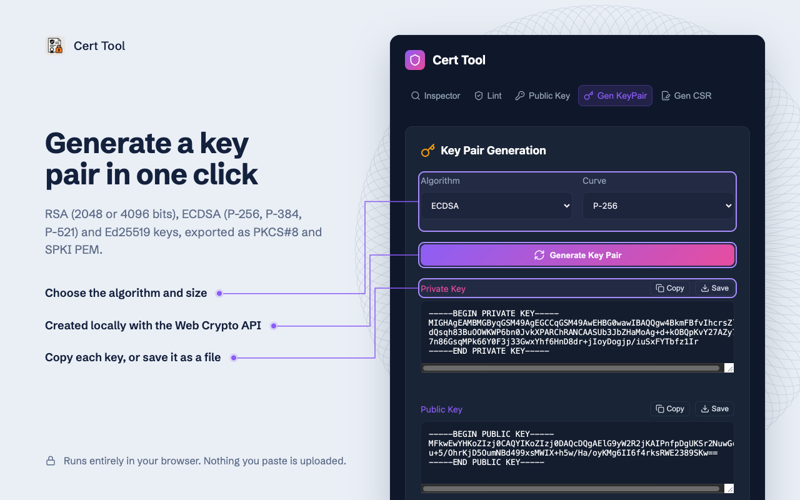
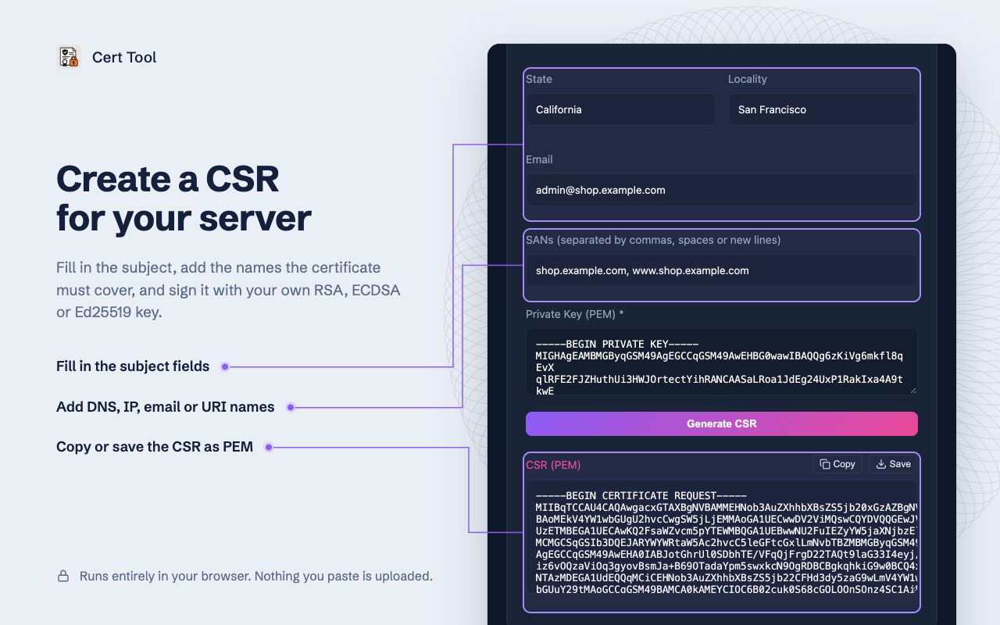

# Cert Tool Chrome Extension

A powerful and elegant Chrome extension for handling X.509 certificates and cryptographic keys. Designed with a premium dark-mode interface and glassmorphism aesthetics.

## Features

### 1. Certificate/CSR Inspector
View detailed information about certificates and signing requests.

- **Comprehensive View**: Shows Serial Number, Subject, Issuer, Validity, Public Key (RSA, RSA-PSS, ECDSA curves, Ed25519, Ed448, ML-DSA), and Signature Algorithm. Non-ASCII names are decoded correctly.
- **Fingerprints**: SHA-256 and SHA-1 fingerprints of a certificate, as `openssl x509 -fingerprint` and Chrome's certificate viewer show them, and the public key pin (`pin-sha256`, the base64 SHA-256 of the public key) of a certificate or CSR. Each has its own Copy button.
- **Extension Decoding**: Human-readable decoding for SANs, Key/Authority Key Identifiers, Key Usage, Extended Key Usage (EKU), Basic Constraints, CRL Distribution Points, Authority Information Access, Certificate Policies, embedded SCTs, Name Constraints, and OCSP Must-Staple. Lists such as SANs and CRL URIs are shown one entry per row.
- **Full Chains**: Paste a whole chain (e.g. `fullchain.pem`) to see it as a diagram: each certificate with its key and days left, linked to the certificate that issued it. Issuers that are listed out of order or missing are named, and a click on a certificate shows its details.
- **This Site's Certificate**: Click *Show this site's certificate* to load the chain Chrome verified for the site in the current tab, from the leaf through the intermediates to the root, each labeled Leaf, Intermediate, or Root. A summary shows the TLS version, key exchange group, and cipher, and whether Chrome accepted the certificate. The chain is also put in the input as PEM, so you can copy it or lint it.
- **How the site's certificate is read**: Chrome gives extensions no direct way to read a page's certificate, so Cert Tool briefly attaches Chrome's debugger to the tab (the `debugger` permission; Chrome shows a "started debugging this browser" bar meanwhile). It has the tab send a HEAD request without cookies to the site's home page, or to the page on the same site that the home page redirects to. Redirects to other sites are not followed, and the address of the page you are on is not sent. It then reads the certificate Chrome received for that response and detaches. The page's content is not read or changed. Chrome does not let an extension debug a tab while another extension's frame is in it (Vimium's bar, for example), so Cert Tool then sends a HEAD request without cookies from its own popup instead, still blocking redirects to other sites, and reads the certificate of that connection; the summary says so. For a few sites Chrome's chain stops below the root, because Chrome trusts an intermediate directly (Google Trust Services' WE2 for youtube.com, for example); the summary and the diagram say so.

### 2. Inspect Certificates on Web Pages
Check certificates and CSRs pasted into docs, issues, or CI logs without copying them into the popup.

- **Scan this page**: The button on the Inspector tab marks every certificate and CSR on the current page with a badge showing its name and days left (green, amber under 30 days, red when expired or not yet valid). Hover or click a badge for the full details; a pasted chain gets one badge listing every entry.
- **Right-click a selection**: Select a PEM block, right-click, and pick *Inspect certificate with Cert Tool*.
- **Only when you ask**: Cert Tool reads a page only after you click the button or the menu item (the `activeTab` permission), never in the background, and the page text never leaves your browser. Browser pages such as `chrome://` and the Chrome Web Store cannot be scanned.

### 3. Certificate Linter
Check whether a server certificate is safe to deploy, similar to [zlint](https://github.com/zmap/zlint) but running entirely in the browser.

- **30 checks**: Expiry, hostname coverage, SAN/EKU/Basic Constraints, DNS name syntax, key type and size, weak signatures, duplicate extensions, and the CA/Browser Forum TLS Baseline Requirements (validity limits, permitted algorithms, policy OIDs, revocation info, CT, and more).
- **Two profiles**: *Public CA* applies the Baseline Requirements and browser root-program rules; *Private CA* applies only what browsers and operating systems enforce (e.g. Apple's 825-day limit). The profile is auto-detected from the certificate policies and can be overridden.
- **Hostname check**: Optionally verify that a hostname, IP address, or URL is covered by the SAN (wildcards and IDNs supported).
- **Cited sources**: Every finding links back to the BR section, RFC, or root-program policy it comes from.
- **Out of scope**: Chain building, revocation status lookups, SCT signature verification, CSRs, and CA certificates.

### 4. Public Key
Two tools, on the **Derive** and **Match** sub-tabs.

- **Derive**: Extract the public key from a private key (PKCS#8, PKCS#1 or SEC1), a certificate or a CSR. The input type and algorithm are detected automatically.
- **Match**: Paste two PEMs to check that they are for the same key pair: a private key and its certificate or CSR, a CSR and the certificate issued from it, or two certificates that share a key. Paste a `fullchain.pem` as is; its first certificate is compared, and the verdict names it and says how many other blocks were left out. The keys are compared by their numbers, not their bytes, so an EC key written compressed still matches. The verdict shows what it rests on: what was compared, and each key's public key pin (`pin-sha256`), the one the Inspector shows, with a Copy button to check it elsewhere.

### 5. Key Pair Generation
Generate cryptographic key pairs instantly using the Web Crypto API.

- **Algorithms**: RSA (2048, 4096 bits), ECDSA (P-256, P-384, P-521), and Ed25519.
- **Standard Formats**: Private keys are exported in **PKCS#8** and public keys in **SPKI**.
- **Save As**: Easily download keys with a standard OS save dialog.

### 6. CSR Generation
Create Certificate Signing Requests (CSR) with a user-friendly form.

- **Customizable DN**: Set Common Name, Organization, Country, and more.
- **SAN Support**: Add multiple Subject Alternative Names (DNS, IPv4/IPv6, Email, URI), separated by commas, spaces or new lines. Each one is checked before the CSR is made.
- **Flexible Signing**: Sign the request with your own RSA, ECDSA (P-256, P-384, P-521) or Ed25519 key, in PKCS#8, PKCS#1 or SEC1 PEM. RSA signs with SHA-256, and ECDSA with the hash that matches its curve.

See [CHANGELOG.md](CHANGELOG.md) for what changed in each release.

## Privacy
Cert Tool runs entirely in your browser and sends nothing to its developer or anyone else. The only request it causes is a HEAD request without cookies to the site you are visiting, when you click *Show this site's certificate*. See [PRIVACY.md](PRIVACY.md) for details.

## Installation

Cert Tool needs Chrome 137 or later, the first version whose Web Crypto supports Ed25519.

1. Clone this repository.
2. Run `npm install` to install dependencies.
3. Run `npm run build` to generate the production build in the `dist` folder.
4. Open Chrome and navigate to `chrome://extensions`.
5. Enable "Developer mode" (top right).
6. Click "Load unpacked" and select the `dist` directory.

## Technology Stack
- **Framework**: Vite + React + TypeScript
- **Crypto Library**: [node-forge](https://github.com/digitalbazaar/forge) & Web Crypto API
- **ASN.1 Parsing (Linter & Inspector)**: [@peculiar/asn1-x509](https://github.com/PeculiarVentures/asn1-schema) & [asn1js](https://github.com/PeculiarVentures/asn1.js)
- **Icons**: [Lucide React](https://lucide.dev/)
- **Styling**: Vanilla CSS with Glassmorphism effects

## Maintaining the Linter
- `node scripts/update-tlds.mjs` refreshes the IANA TLD list used to detect internal names.
- `scripts/gen-lint-fixtures.sh` regenerates the test certificates (requires OpenSSL 3.4+).
- Rules follow CA/Browser Forum TLS BR v2.3.1, Chrome Root Program Policy v1.8, and Mozilla Root Store Policy v3.1. Date-based rules (e.g. the validity limits that tighten in 2027 and 2029) are already encoded.

