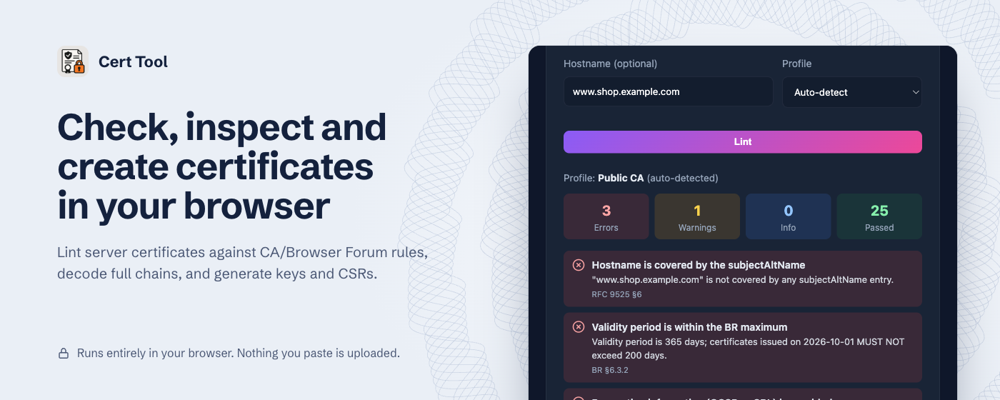
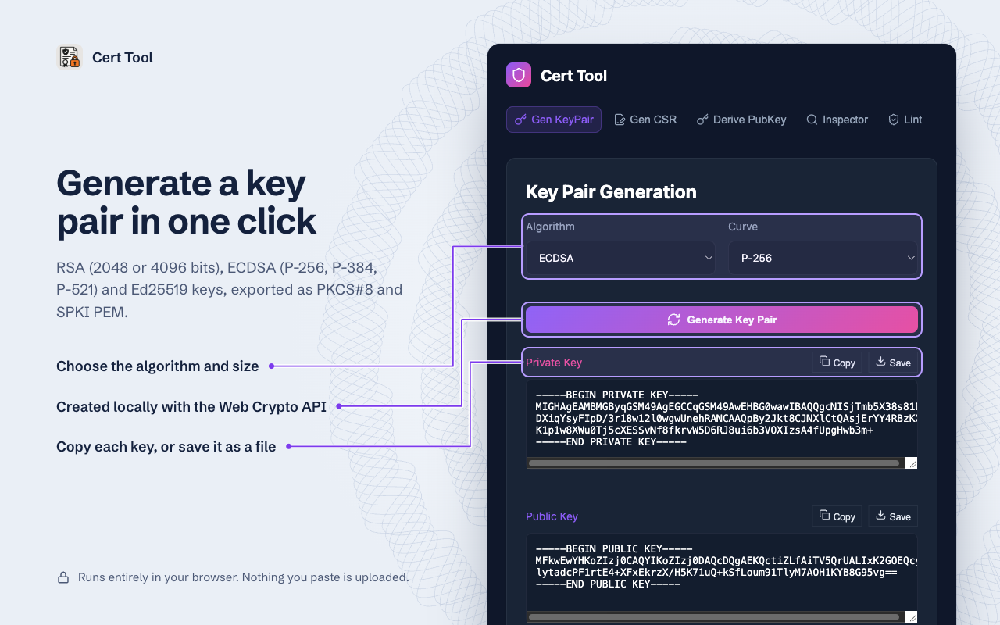
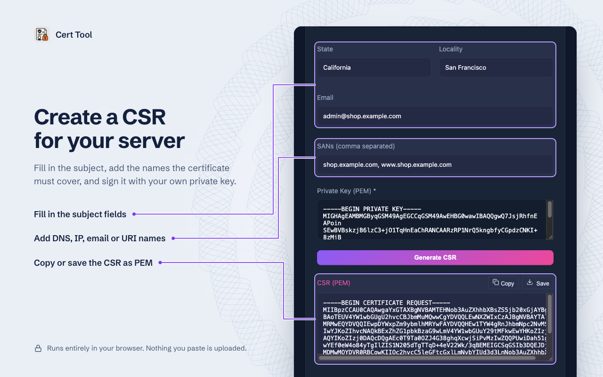
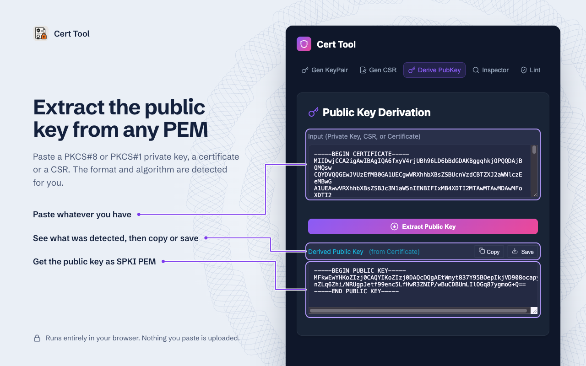
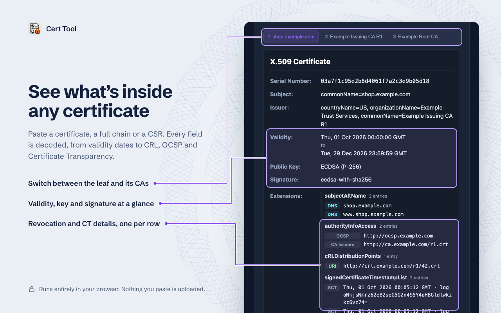
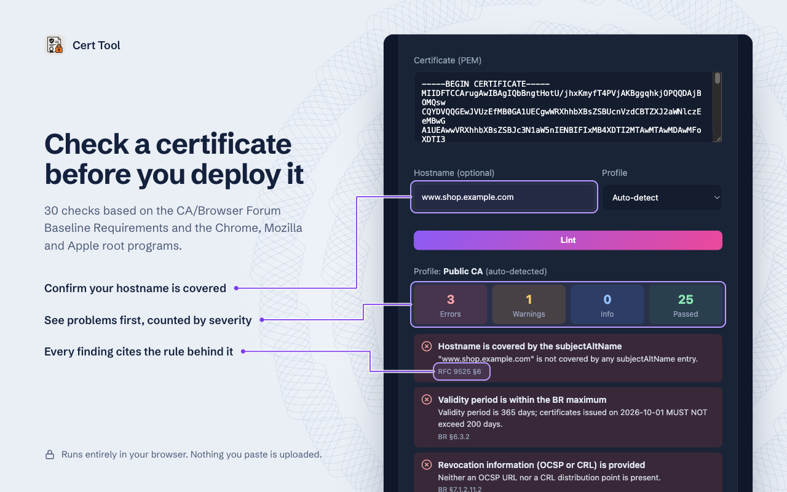

# Cert Tool Chrome Extension

A powerful and elegant Chrome extension for handling X.509 certificates and cryptographic keys. Designed with a premium dark-mode interface and glassmorphism aesthetics.

## Features

### 1. Key Pair Generation
Generate cryptographic key pairs instantly using the Web Crypto API.

- **Algorithms**: RSA (2048, 4096 bits), ECDSA (P-256, P-384, P-521), and Ed25519.
- **Standard Formats**: Private keys are exported in **PKCS#8** and public keys in **SPKI**.
- **Save As**: Easily download keys with a standard OS save dialog.

### 2. CSR Generation
Create Certificate Signing Requests (CSR) with a user-friendly form.

- **Customizable DN**: Set Common Name, Organization, Country, and more.
- **SAN Support**: Add multiple Subject Alternative Names (DNS, IP, Email, URI).
- **Flexible Signing**: Sign the request using your own private key.

### 3. Public Key Derivation
Extract the public key component from various sources.

- **Input Types**: Supports Private Keys (PKCS#8/PKCS#1), Certificates, or CSRs.
- **Auto-Detection**: Automatically identifies the input type and algorithm.

### 4. Certificate/CSR Inspector
View detailed information about certificates and signing requests.

- **Comprehensive View**: Shows Serial Number, Subject, Issuer, Validity, Public Key (RSA, RSA-PSS, ECDSA curves, Ed25519, Ed448, ML-DSA), and Signature Algorithm. Non-ASCII names are decoded correctly.
- **Extension Decoding**: Human-readable decoding for SANs, Key/Authority Key Identifiers, Key Usage, Extended Key Usage (EKU), Basic Constraints, CRL Distribution Points, Authority Information Access, Certificate Policies, embedded SCTs, Name Constraints, and OCSP Must-Staple. Lists such as SANs and CRL URIs are shown one entry per row.
- **Full Chains**: Paste a whole chain (e.g. `fullchain.pem`) and switch between the leaf and intermediates.

### 5. Certificate Linter
Check whether a server certificate is safe to deploy, similar to [zlint](https://github.com/zmap/zlint) but running entirely in the browser.

- **30 checks**: Expiry, hostname coverage, SAN/EKU/Basic Constraints, DNS name syntax, key type and size, weak signatures, duplicate extensions, and the CA/Browser Forum TLS Baseline Requirements (validity limits, permitted algorithms, policy OIDs, revocation info, CT, and more).
- **Two profiles**: *Public CA* applies the Baseline Requirements and browser root-program rules; *Private CA* applies only what browsers and operating systems enforce (e.g. Apple's 825-day limit). The profile is auto-detected from the certificate policies and can be overridden.
- **Hostname check**: Optionally verify that a hostname, IP address, or URL is covered by the SAN (wildcards and IDNs supported).
- **Cited sources**: Every finding links back to the BR section, RFC, or root-program policy it comes from.
- **Out of scope**: Chain building, revocation status lookups, SCT signature verification, CSRs, and CA certificates.

### 6. Inspect Certificates on Web Pages
Check certificates and CSRs pasted into docs, issues, or CI logs without copying them into the popup.
- **Scan this page**: The button on the Inspector tab marks every certificate and CSR on the current page with a badge showing its name and days left (green, amber under 30 days, red when expired or not yet valid). Hover or click a badge for the full details; a pasted chain gets one badge listing every entry.
- **Right-click a selection**: Select a PEM block, right-click, and pick *Inspect certificate with Cert Tool*.
- **Only when you ask**: Cert Tool reads a page only after you click the button or the menu item (the `activeTab` permission), never in the background, and the page text never leaves your browser. Browser pages such as `chrome://` and the Chrome Web Store cannot be scanned.

See [CHANGELOG.md](CHANGELOG.md) for what changed in each release.

## Installation

1. Clone this repository.
2. Run `npm install` to install dependencies.
3. Run `npm run build` to generate the production build in the `dist` folder.
4. Open Chrome and navigate to `chrome://extensions`.
5. Enable "Developer mode" (top right).
6. Click "Load unpacked" and select the `dist` directory.

## Technology Stack
- **Framework**: Vite + React + TypeScript
- **Crypto Library**: [node-forge](https://github.com/digitalbazaar/forge) & Web Crypto API
- **ASN.1 Parsing (Linter & Inspector)**: [@peculiar/asn1-x509](https://github.com/PeculiarVentures/asn1-schema) & [asn1js](https://github.com/PeculiarVentures/asn1.js)
- **Icons**: [Lucide React](https://lucide.dev/)
- **Styling**: Vanilla CSS with Glassmorphism effects

## Maintaining the Linter
- `node scripts/update-tlds.mjs` refreshes the IANA TLD list used to detect internal names.
- `scripts/gen-lint-fixtures.sh` regenerates the test certificates (requires OpenSSL 3.4+).
- Rules follow CA/Browser Forum TLS BR v2.3.1, Chrome Root Program Policy v1.8, and Mozilla Root Store Policy v3.1. Date-based rules (e.g. the validity limits that tighten in 2027 and 2029) are already encoded.

---
Developed with focus on security, usability, and modern aesthetics.
